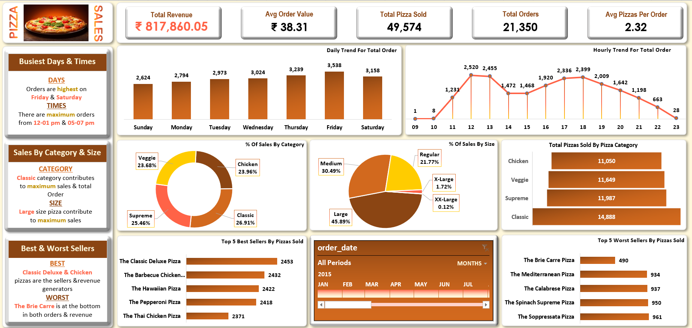

# 🍕 Pizza Sales Analysis & Interactive Dashboard

An end-to-end data analytics project analyzing pizza sales data using PostgreSQL for data extraction & KPI validation, connected live via ODBC to an interactive Microsoft Excel dashboard.

## 🛠️ Tech Stack
- **Database:** PostgreSQL (KPI calculations, aggregations, query analysis)
- **Data Pipeline:** ODBC Driver (Live connection between PostgreSQL and Excel)
- **Reporting:** Microsoft Excel (Pivot Tables, Slicers, Custom UI Layout)

## 📌 Key Metrics
- **Total Revenue:** ₹8,17,860.05
- **Total Orders:** 21,350
- **Average Order Value:** ₹38.31
- **Total Pizzas Sold:** 49,574

## 💡 Business Insights
1. **Peak Times:** Orders peak on Fridays and Saturdays, primarily during 12:00–1:00 PM and 5:00–7:00 PM.
2. **Category Split:** The Classic category generates the highest sales and order volume (26.91%).
3. **Size Distribution:** Large pizzas lead customer preference at 45.89% of total sales.
4. **Best Seller:** The Classic Deluxe Pizza (2,453 units sold).
5. **Lowest Seller:** The Brie Carre Pizza (490 units sold).

## 📂 Project Structure
- Excel-pizza_sales-dashboard.xlsx - Excel dashboard with dynamic slicers and charts.
- pizza_queries.sql - SQL scripts for business queries and KPI validation.
